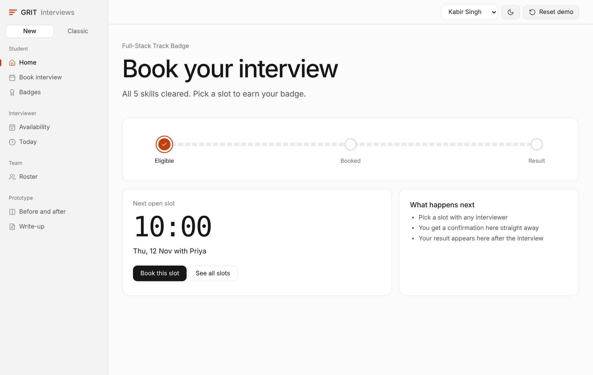
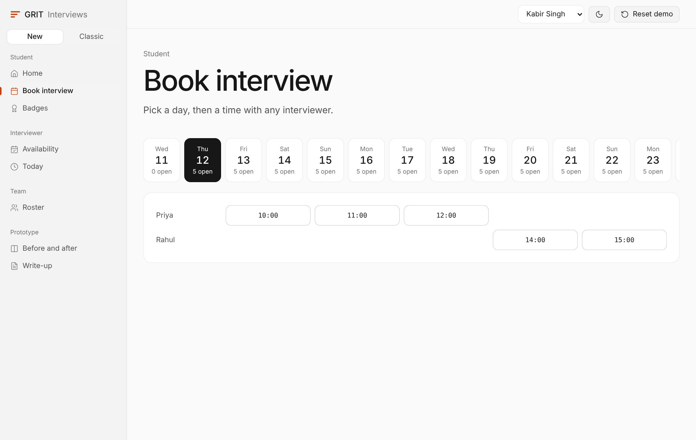
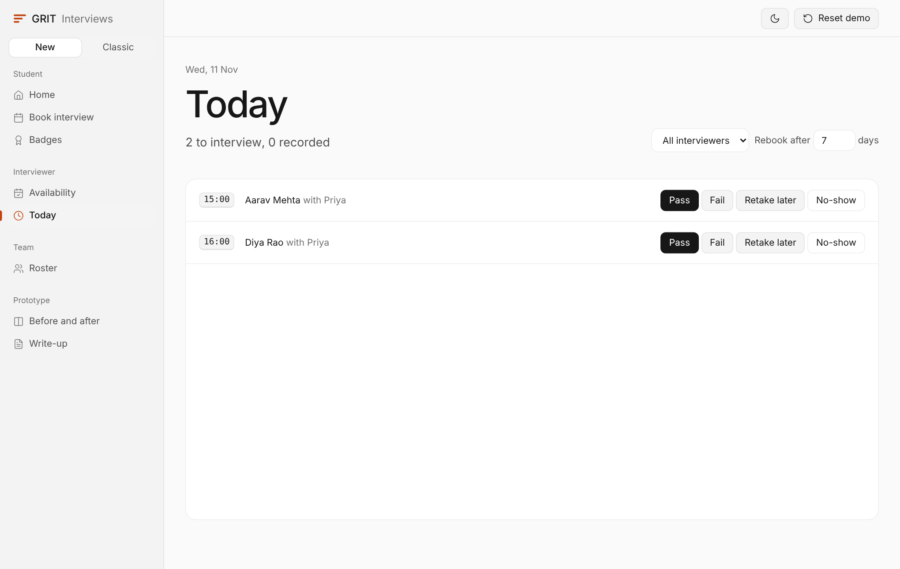
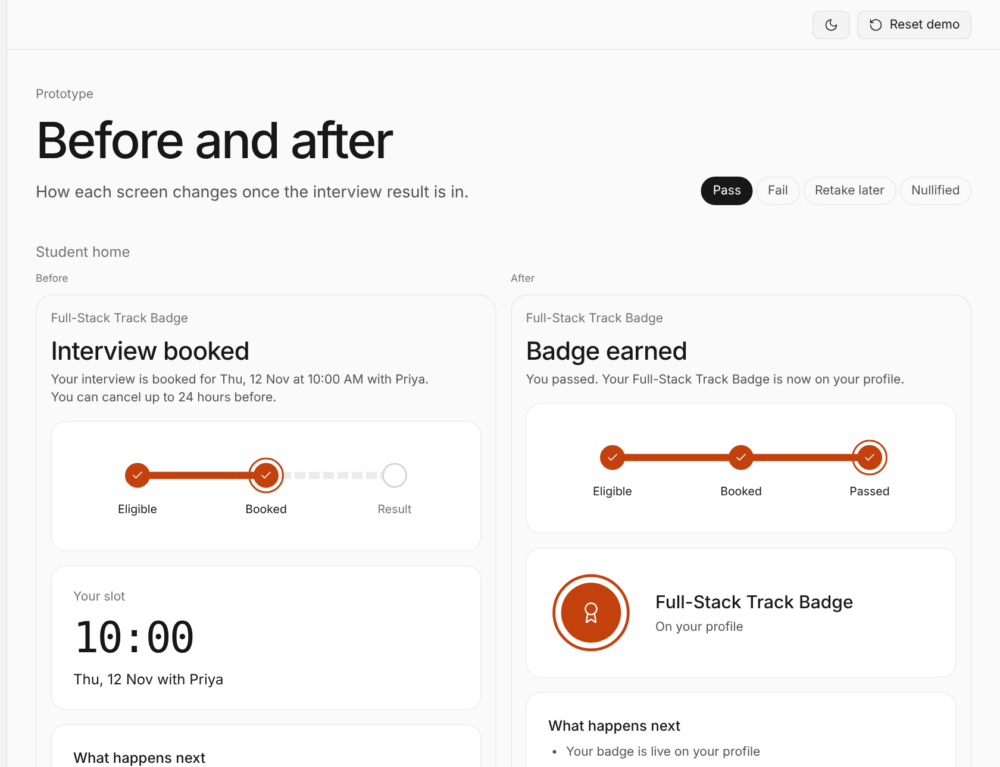
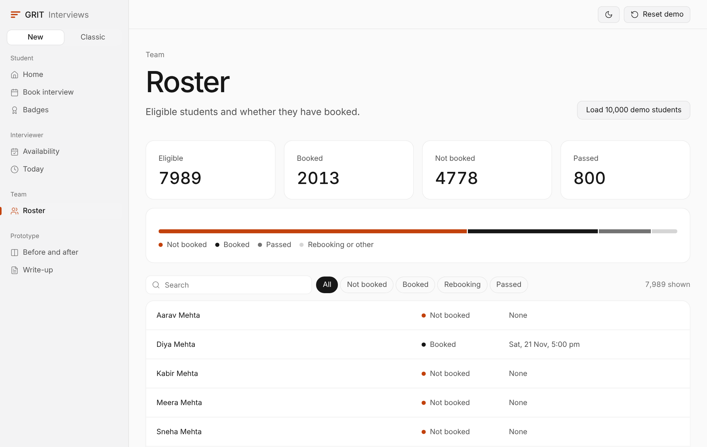
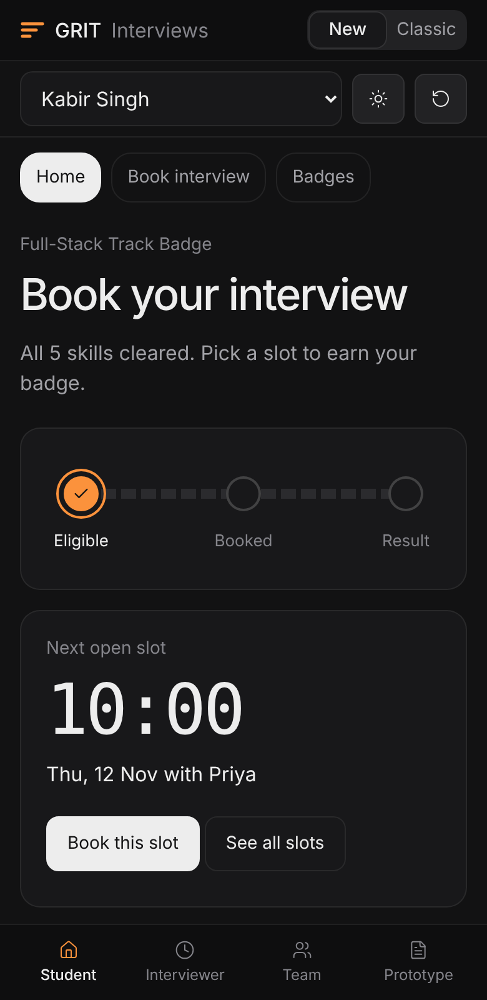

<div align="center">

# GRIT Interview Scheduler

**Interview scheduling for GRIT Track Badges.** Eligible students book a slot, interviewers set their availability, and the interview team records the result and sees who hasn't booked yet.

[](https://punitpritam788.github.io/grit-interview-scheduler/)
[](docs/writeup.pdf)




</div>

> Built for the **AI Product Engineer, Round 1** assignment. Live link: <https://punitpritam788.github.io/grit-interview-scheduler/>

## The problem

GRIT is a year-long skilling competition for NIAT engineering students. After a student clears every skill a Track Badge needs, they take a live online interview to earn it. A small team of interviewers runs these interviews, each with their own availability. A badge is nullified if the student is flagged for malpractice later.

## What the prototype does

| Assignment requirement | Where to see it | Status |
|---|---|---|
| Eligible students book a slot from their dashboard | **Student: Home** and **Book interview**. Pick a day, then a time. Only eligible students can book. | Done |
| Interviewers set and manage availability | **Interviewer: Availability**. Tap an hour to open or close it. Booked hours are protected. | Done |
| Team records pass, fail or retake later | **Interviewer: Today**. Pass, Fail, Retake later, No-show, with a rebook-after setting. | Done |
| Students see status and result on their dashboard | **Student: Home** and **Badges** update after every change. | Done |
| Team sees who has and hasn't booked | **Team: Roster**. Counts, a stacked bar, search and filters. | Done |
| Badge nullified after a malpractice flag | **Team: Roster**, "Flag malpractice" on a passed student. | Done |
| Write-up, 2 pages max: states, edge cases, data model | **Prototype: Write-up** tab, and [`docs/writeup.pdf`](docs/writeup.pdf) (2 pages). | Done |
| 3 most important student messages, exactly as shown | Shown on the student Home screen and listed in the write-up. See below. | Done |
| Before and after screens | **Prototype: Before and after**. Student Home, Badges and Book, for pass, fail, retake later and nullified. | Done |
| Live link | GitHub Pages: <https://punitpritam788.github.io/grit-interview-scheduler/> | Done once Pages is on |

## Screens

| Book interview | Interviewer: Today |
|---|---|
|  |  |

| Before and after the result | Roster with 10,000 students |
|---|---|
|  |  |



## Student journey: the states

| State | Enters when | Leaves to |
|---|---|---|
| Not eligible | Skills still missing | Eligible: last skill cleared |
| Eligible | All skills cleared, or no-show, or cool-off over | Booked: student books a slot |
| Booked | Slot reserved in one atomic step | Eligible: cancel or no-show. Passed, Failed or Retake later: interviewer records |
| Passed | Interviewer records pass, badge issued | Nullified: malpractice flag |
| Failed, Retake later | Interviewer records, `retry_after` set (default 7 days) | Eligible once `retry_after` passes |
| Nullified | Malpractice flag on a passed badge | Terminal (team can reinstate by hand) |

## The 3 student messages

Shown exactly like this on the student Home screen.

**Booking confirmed**
```
Your interview is booked for Fri, 14 Nov at 10:00 AM with Priya.
You can cancel up to 24 hours before.
```

**Passed**
```
You passed. Your Full-Stack Track Badge is now on your profile.
```

**Retake later**
```
You're almost there. Your interviewer wants a second look.
You can rebook from Fri, 21 Nov.
```

## Data model and no double booking

```
students(id, name, skills_cleared, eligible_at)
interviewers(id, name)
slots(id, interviewer_id, starts_at, ends_at, status[open|booked|done],
      UNIQUE(interviewer_id, starts_at))
bookings(id, slot_id, student_id, badge_id, status[active|cancelled|no_show|done], created_at,
         UNIQUE(slot_id) WHERE status='active',
         UNIQUE(student_id, badge_id) WHERE status='active')
outcomes(id, booking_id UNIQUE, result[pass|fail|retake], retry_after, notes, recorded_by, recorded_at)
badges(student_id, badge_id, status[earned|nullified], nullified_reason, PRIMARY KEY(student_id, badge_id))
```

Two students cannot take the same slot because of the partial unique index on `bookings(slot_id) WHERE status='active'`. If two inserts arrive together, one wins and the other gets a constraint error, which the UI turns into "That slot was just taken. Please pick another." No application-level locking is needed. The prototype mimics this with a check-and-set on the slot, and `check.js` proves it.

## Edge cases and assumptions

- Two students, one slot: the second sees "slot just taken" and the list refreshes.
- One active booking per student per badge. Cancel first to rebook.
- A recorded slot never reopens, and a slot whose hour has passed cannot be booked.
- An interviewer cannot close an hour that is already booked. The team reassigns or cancels and notifies the student.
- No-show: the slot is freed and the student returns to Eligible with no penalty (assumption).
- Cancelling is allowed up to 24 hours before the slot. After that the button is replaced by a note.
- Fail and retake later both lock rebooking until `retry_after`. Retake means close, one more look.
- A malpractice flag after a pass nullifies the badge and the student sees a clear message.
- All times are IST (assumption).
- Open questions: maximum retakes, interviewer conflicts of interest, who handles appeals.

## When the data is big

- **Never draw every row.** Roster and Today use a windowed list, so about a dozen rows exist in the page however many students there are. In production, page from the server with keyset pagination.
- **Never scan.** Lookups go through Maps built once per change. In a database these are indexes on `slots(starts_at)`, `bookings(student_id)` and `bookings(slot_id)`.
- **Load only what is on screen.** Booking reads one day at a time and shows 20 interviewers with a Show more button.
- **Cheap input.** Search is debounced and repaints only the list. Saves are debounced into a single write.

Try it: open **Team: Roster** and press **Load 10,000 demo students**.

## Run it

No build step and no dependencies.

```bash
# open the file in any browser
open index.html            # or double-click it

# optional: run the checks (Playwright)
npm install
npx playwright install chromium
npm test
```

`check.js` verifies: no double booking, the 24-hour cancel rule, the three messages word for word, the 10,000-student roster, no sideways scroll on a 320px phone, the `#classic` link, and that the write-up prints on 2 pages.

## Project files

```
index.html          the whole app: new design plus the classic version (switch: New / Classic, or open #classic)
check.js            one-command checks
docs/writeup.pdf    the 2-page write-up
docs/screens/       screenshots used in this README
```

State lives in the browser (localStorage). **Reset demo** restores the starting data.

## Publish with GitHub Pages

Settings, Pages, Build and deployment, Deploy from a branch, `main`, `/ (root)`.

## License

MIT. See [LICENSE](LICENSE).
